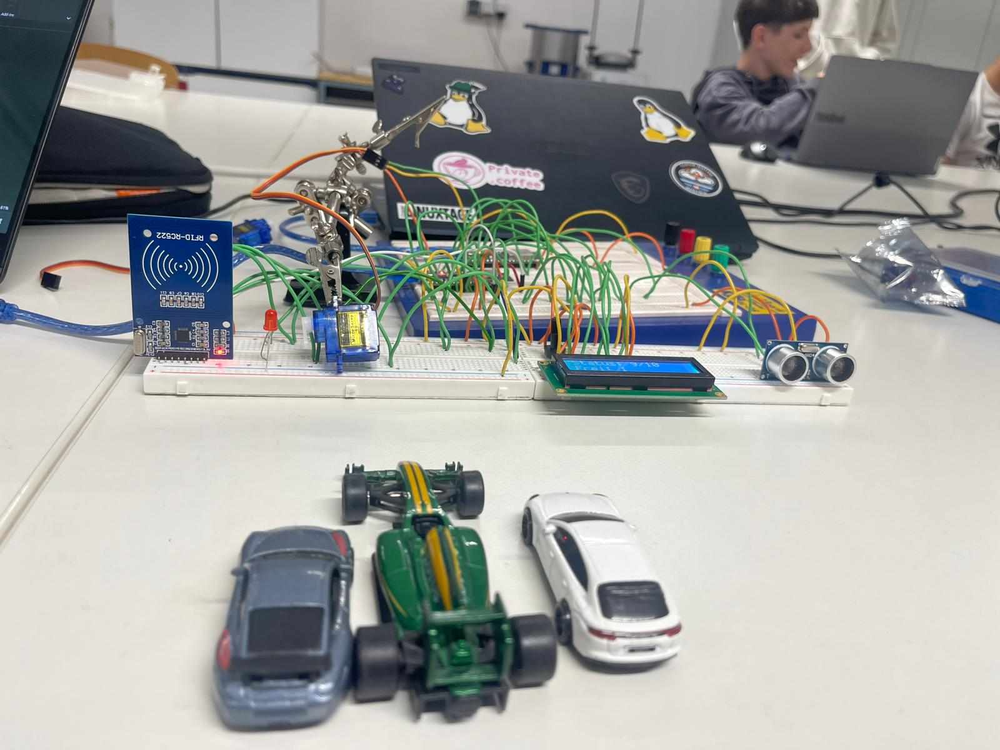
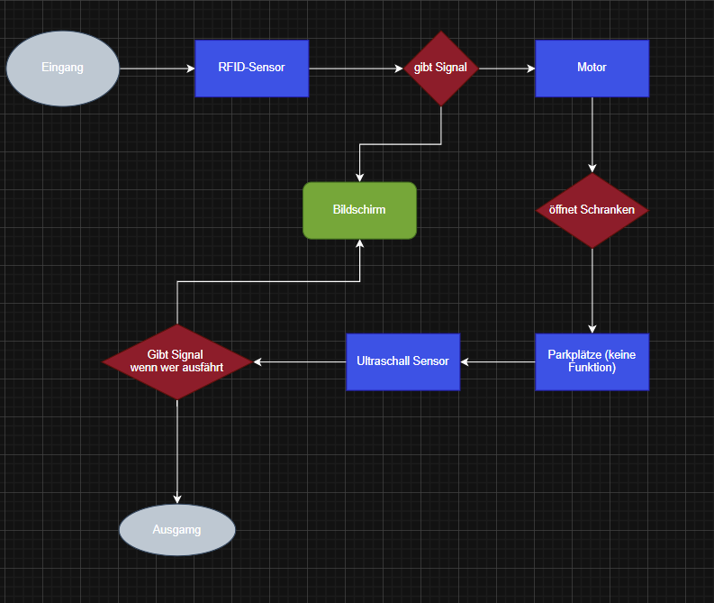
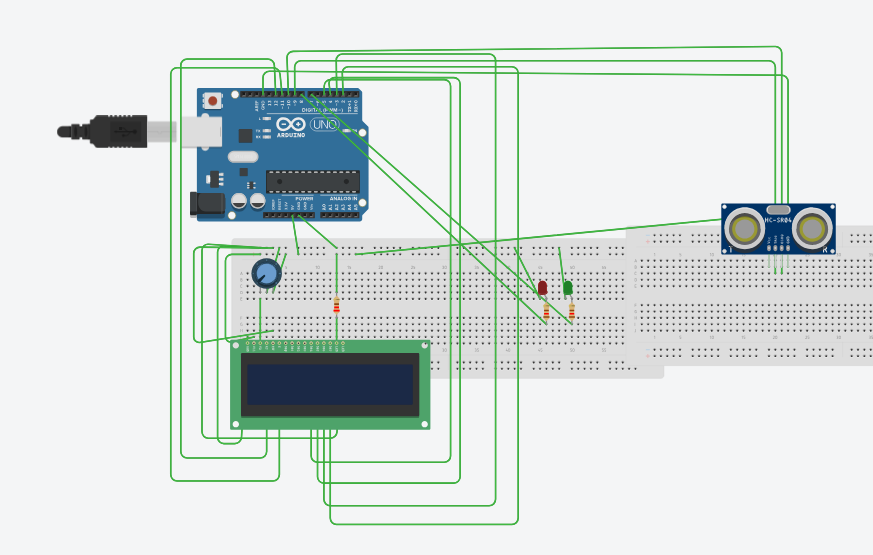
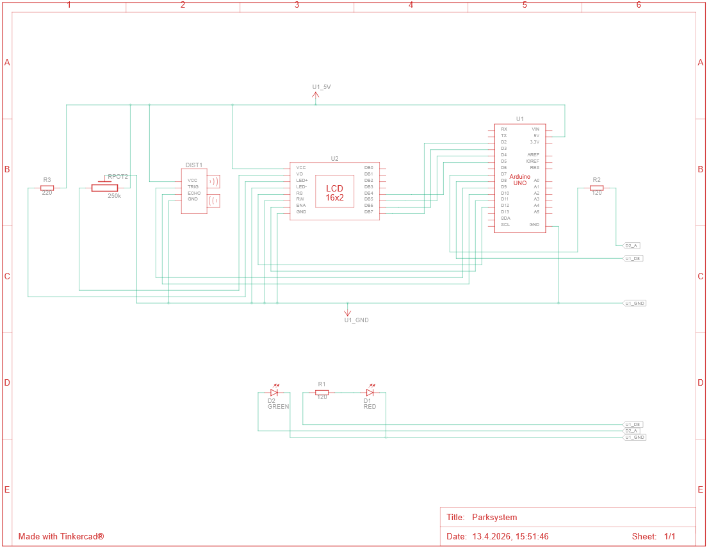
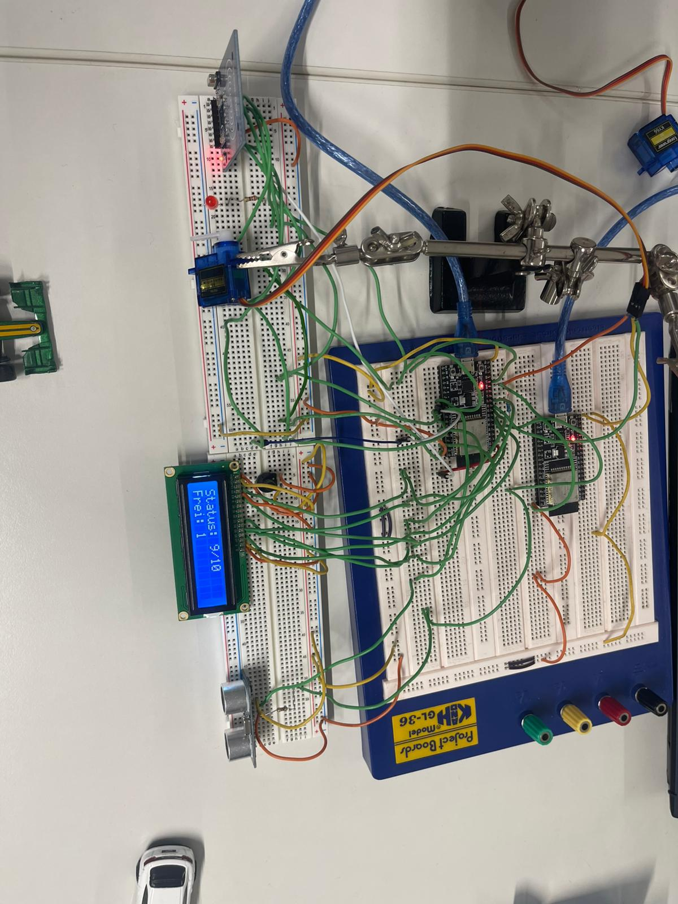
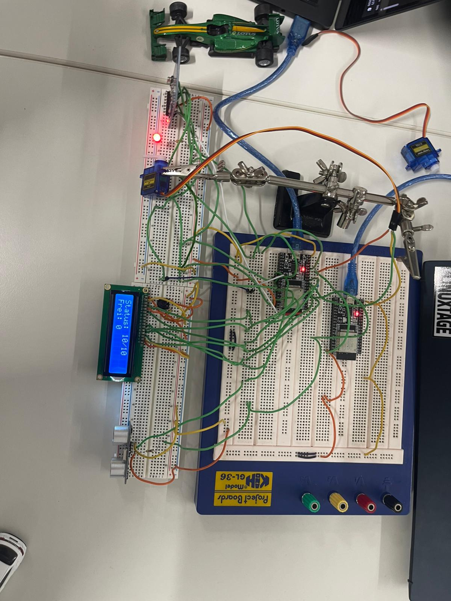
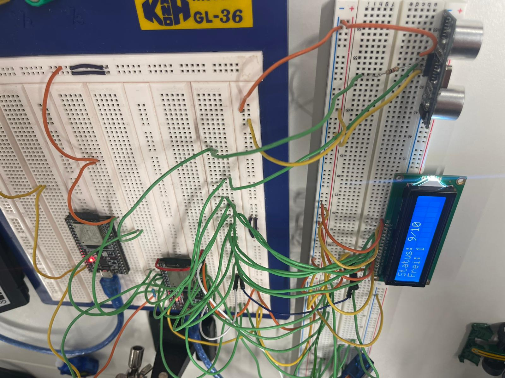
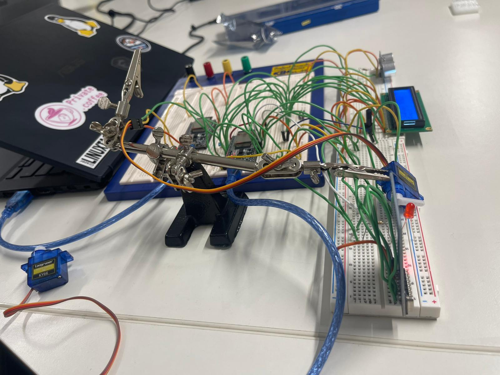
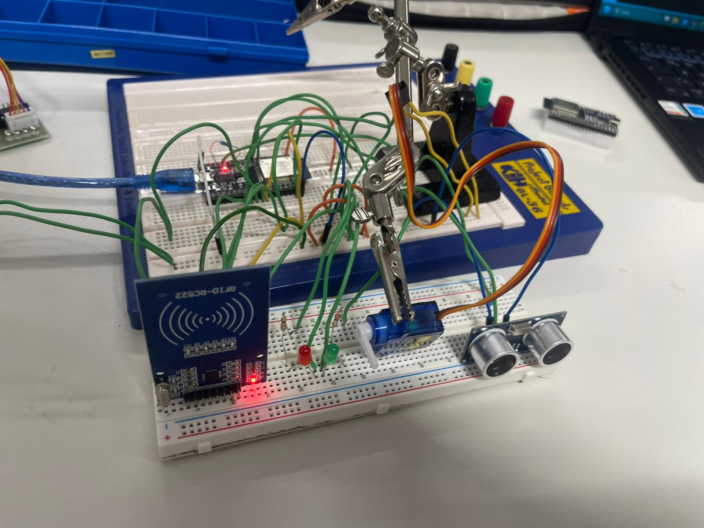
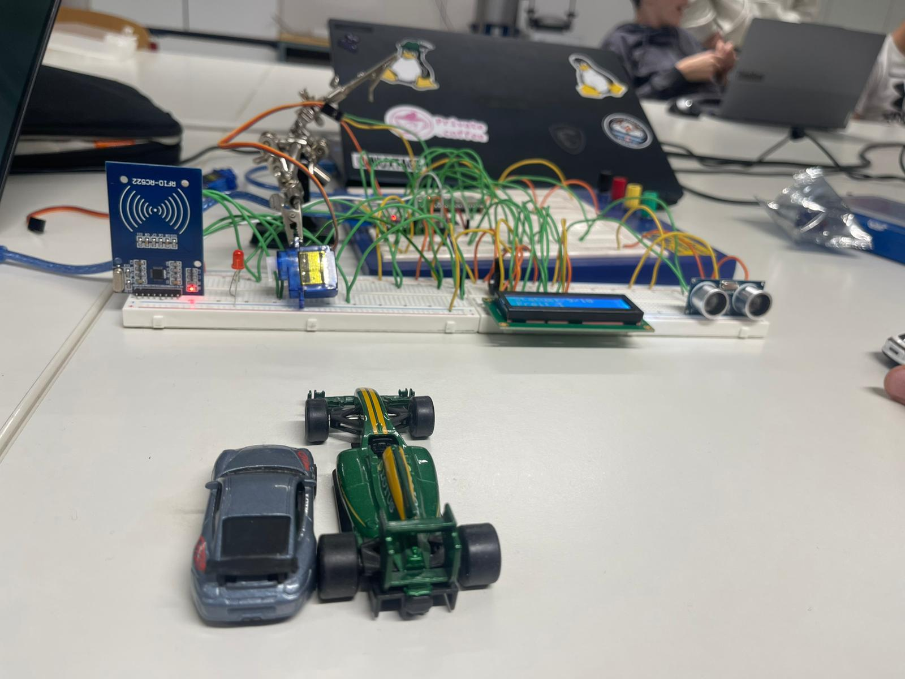

<p align="center">
  
</p>

<h1 align="center">🚗 Smart Parking System</h1>

<p align="center">
  IoT parking garage with RFID entry, automatic barrier, exit detection and a live web dashboard — built on an ESP32.
</p>

<p align="center">
  
  
  
  
</p>

> **Lab Protocol** · Subject: Lab · Class: 2IT · HTL Leoben
> **Authors:** Alexander Wetzlhütter, Matthias Pichler · **Date:** 13.04.2026

<p align="center">
  
</p>

---

## 📋 Table of Contents

- [How It Works](#-how-it-works)
- [Repository Structure](#-repository-structure)
- [Components](#-components)
- [Pin Assignment](#-pin-assignment)
- [System Flowchart](#-system-flowchart)
- [Tinkercad Simulation & Schematic](#-tinkercad-simulation--schematic)
- [Getting Started](#-getting-started)
- [Web Dashboard](#-web-dashboard)
- [Serial Protocol](#-serial-protocol)
- [Gallery](#-gallery)
- [Known Issues & Notes](#-known-issues--notes)
- [License](#-license)

---

## 💡 How It Works

1. A driver holds an **RFID keycard** to the reader at the entrance.
2. If a space is free, the **barrier (servo)** opens for 3 seconds and the counter goes up.
   If the garage is full, the LCD shows `!!! VOLL !!!` and the barrier stays closed.
3. An **ultrasonic sensor** at the exit detects a leaving car and the counter goes down.
4. The **LCD** always shows the occupied and free spaces (e.g. `Status: 9/10`, `Frei: 1`).
5. A **red LED** lights up when the garage is full.
6. The ESP32 sends its status over USB to a **web dashboard** in the browser.

---

## 📁 Repository Structure

```
Smart-Parksystem/
├── CODE/
│   ├── Firmware.ino         # ESP32 firmware (Arduino IDE)
│   └── WEB_Interface.html   # Browser dashboard (Web Serial)
├── Infos/
│   ├── Protokoll.doc        # Full lab protocol
│   └── ESP32-Belegung für RFID, LCD, Sensor.xlsx   # Pin planning
├── Screenshots/             # Photos, flowchart, Tinkercad images
├── LICENSE
└── README.md
```

---

## 🔧 Components

| Component | Type | Purpose |
|-----------|------|---------|
| ESP32 DevKit | Microcontroller | Main controller |
| RFID-RC522 | Sensor | Entry authentication via keycard |
| HC-SR04 | Sensor | Exit detection (ultrasonic) |
| SG90 micro servo | Actuator | Barrier gate |
| LCD 16×2 (HD44780) | Actuator | Shows occupied / free spaces |
| Red LED + resistor | Actuator | "Garage full" indicator |
| Potentiometer | Passive | LCD contrast |
| Breadboard, jumper wires | — | Wiring |

---

## 📌 Pin Assignment

| Module | Signal | ESP32 GPIO |
|--------|--------|-----------|
| **RFID-RC522** (SPI) | SDA / SS | 5 |
| | SCK | 18 |
| | MISO | 19 |
| | MOSI | 23 |
| | RST | 17 |
| | VCC | **3.3 V** |
| **LCD 16×2** (4-bit mode) | RS | 21 |
| | E | 22 |
| | D4 / D5 / D6 / D7 | 25 / 27 / 32 / 33 |
| **HC-SR04** | TRIG | 16 |
| | ECHO | 34 *(via voltage divider, see notes)* |
| **Servo** | PWM | 26 |
| **LED (full)** | + (via resistor) | 13 |

The original pin planning is in [`Infos/ESP32-Belegung für RFID, LCD, Sensor.xlsx`](Infos/).

---

## 🔄 System Flowchart

<p align="center">
  
</p>

---

## 🖥️ Tinkercad Simulation & Schematic

> ⚠️ Tinkercad does not support the ESP32, so the simulation uses an **Arduino UNO** as a stand-in. The wiring logic is equivalent; the pin numbers differ.

<p align="center">
  
</p>

<p align="center">
  
</p>

---

## 🚀 Getting Started

1. **Install the Arduino IDE** and add ESP32 support
   (*Boards Manager* → search for **esp32** by Espressif).
2. **Install the libraries** via *Library Manager*:

   | Library | Used for |
   |---------|----------|
   | `MFRC522` | RFID reader |
   | `LiquidCrystal` | LCD (usually pre-installed) |
   | `ESP32Servo` | Servo control |

3. Open `CODE/Firmware.ino`, select your ESP32 board and COM port, and **upload**.
4. Open the Serial Monitor at **115200 baud** — you should see `STATUS:{...}` lines.
5. Close the Serial Monitor (the port can only be used by one program) and open the [web dashboard](#-web-dashboard).

**Adjustable settings** at the top of `Firmware.ino`:

| Constant | Default | Meaning |
|----------|---------|---------|
| `MAX_PLAETZE` | 10 | Number of parking spaces |
| `SCHRANKE_OFFEN_ZEIT` | 3000 ms | How long the barrier stays open |
| `ULTRASCHALL_DISTANZ` | 10 cm | Distance below which a car counts as detected |
| `AUSFAHRT_COOLDOWN` | 3000 ms | Lock time after an exit was counted |

---

## 📊 Web Dashboard

`CODE/WEB_Interface.html` is a single file — no server needed.

1. Connect the ESP32 via USB.
2. Open the file in **Chrome or Edge** (Firefox and Safari do not support Web Serial).
3. Click **„Gerät verbinden (USB)“** and select the ESP32's port.

The dashboard shows the free spaces, the barrier state and a live activity log.

---

## 🔌 Serial Protocol

The firmware sends one line per event and an `Update` line every 2 seconds (115200 baud):

```
STATUS:{"free":7,"total":10,"barrier":"open","event":"Einfahrt gewaehrt"}
```

| Field | Values |
|-------|--------|
| `free` | Free spaces |
| `total` | Total spaces |
| `barrier` | `open` / `closed` |
| `event` | `System bereit`, `Einfahrt gewaehrt`, `Schranke zu`, `Parkhaus voll!`, `Ausfahrt erkannt`, `Update` |

---

## 📷 Gallery

| | |
|:-:|:-:|
| <br>Top view – 9 of 10 spaces used | <br>Garage full – LED on, `Frei: 0` |
| <br>LCD and ultrasonic sensor | <br>Side view with barrier servo |
| <br>First prototype | <br>Front view |

---

## ⚠️ Known Issues & Notes

| Topic | Note |
|-------|------|
| **HC-SR04 is a 5 V sensor** | Its ECHO pin outputs 5 V, but ESP32 inputs are 3.3 V only. Use a voltage divider (e.g. 1 kΩ / 2 kΩ) on ECHO. |
| **RC522 runs on 3.3 V** | Do not power the RFID module from 5 V. |
| **Breadboard connectivity** | Some breadboard rows were not electrically connected — always check continuity before testing. |
| **Serial Monitor output** | Wrong baud rate causes garbled output — use **115200**. |
| **Any card is accepted** | The firmware does not check card UIDs yet; every RFID card opens the barrier. |
| **Exit detection** | A car is counted only when it *appears* in front of the sensor; a car standing still is not counted twice. |

---

## 📄 License

This project is licensed under the [MIT License](LICENSE).

<p align="center">
  <sub>HTL Leoben · Rohstoffe · Metalle · Logistik · IT · Lab Report 2026</sub>
</p>
